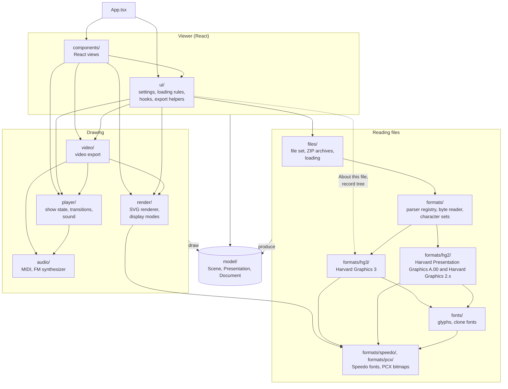

# Harvard Web Viewer

A browser-only viewer for **Harvard Graphics for DOS** files.

| Version | What it opens |
| --- | --- |
| Harvard Graphics 3 (checked against 3.05, 1992) | Charts (`.CH3`), screen shows (`.SH3`) and palettes (`.PL3`, `.PC3`), with the fonts, bitmaps and sounds they name |
| Harvard Graphics 2.10, 2.12 and 2.30 | Charts (`.CHT`) and slide shows (`.SHW`), with the bitmaps they name |
| Harvard Presentation Graphics A.00 (1986) | Charts (`.CHT`) and slide shows (`.SHW`) |

Harvard Graphics for Windows is not supported.

**Open the viewer: <https://unamanic.github.io/harvard-web-viewer/>**

Harvard Graphics was one of the leading charting and presentation programs of the late 1980s and early 1990s, and its files are hard to open today. This viewer reads them in your browser with nothing to install. Files you open are read in the browser tab and are never uploaded anywhere.

## How to use it

1. **Open the viewer** at <https://unamanic.github.io/harvard-web-viewer/>. It runs entirely in your browser; there is nothing to install and no account.
2. **Open your files.** Click **Open a file** (or **Choose files…** on the start page), drag files onto the page, or paste them with Ctrl+V. To open a whole folder, use **Choose a folder…** on the start page or the ▾ next to **Open a file** (**Open a folder…**), or drag the folder in. A `.zip` works too: open or drop one archive that holds a show or chart and the files it names, and the viewer unpacks it in the browser. If the archive holds several shows (or several charts and no show), it asks which one to open; the others stay in the file switcher.
   - Open the **whole folder** a chart or show came from when you can. Charts name their palette (`.PL3`), fonts (`.SPD`), bitmaps (`.PCX`) and other charts in separate files, and shows name their slides; the viewer finds them in the files you opened, whatever their case. Anything it can't find is listed under **About this file**, and **Add missing files…** lets you add it without starting over.
   - Supported files: charts `.CH3` (and A.00/2.x `.CHT`), shows `.SH3` (and A.00/2.x `.SHW`), palettes `.PL3`/`.PC3`, fonts `.SPD`, bitmaps `.PCX`/`.PCC`, sounds `.WAV` and `.MID`, and `.zip` archives of any of these.
3. **Look and move around.**
   - The **Slides** column on the left lists the slides of a show (or the chart you opened); click one to jump to it. When you opened several files, a file switcher at the top of that column picks the chart or show to view.
   - In a show, use → / ← (or Enter, Space, Page Down / Page Up), the show's own keys (for example F1–F10 in the gallery shows) and its on-screen buttons. Slides with a display time move on by themselves; **Pause auto-advance** (or the Pause key) holds them.
   - **Present** shows the slide full screen; **Exit (Esc)** leaves.
4. **Choose how it looks** under **Display** in the right-hand panel:
   - **Display**: VGA ScreenShow (the default, as the original looked on a VGA screen), EGA, Hercules monochrome, or Modern (the stored colours exactly).
   - **Palette**: as saved, or the program's own greyscale palettes.
   - **Transitions**: from the file (default), off, or a demo of every effect; sound on or off.
5. **Export.** **Export PNG / SVG** saves the slide you are looking at; for a show, **Export → Video…** makes a WebM (or MP4) of the whole show with its transitions, timing and sound.
6. **Inspect.** **About this file** shows what the file is, its palette and fonts, and anything worth knowing; **Show raw bytes** opens the record tree and a hex view.

**Try it with a sample.** The repository includes a 20-slide show made in the real Harvard Graphics 3.05, with its charts and pictures: [`samples/claude-vs-codex`](samples/claude-vs-codex). Download the repository (**Code → Download ZIP** on GitHub, or `git clone`), open the viewer, and use **Choose a folder…** on `samples/claude-vs-codex`: the show `CLAUDEVX.SH3` opens first.

## What it can do

- **Charts (`.CH3`).** Draws the copy of the chart stored in the file (the drawn object layer, embedded charts included). When a chart has no stored copy, lays it out from its data: XY (bar, line, area, high/low, point), pie, title, bullet, organisation and table charts.
- **A.00 and 2.x charts (`.CHT`).** Harvard Presentation Graphics A.00 and Harvard Graphics 2.10, 2.12 and 2.30 charts store their data and options, not a drawing, so the viewer lays them out itself: title, list, bullet, column and free-form text charts; bar/line, area and high/low/close charts (stacked, 100%, overlap, horizontal, 3-D, second Y axis, value labels, data table); pies and columns; organisation charts; and multiple charts, which draw the charts they name when you open them together. Slide shows (`.SHW`) play their charts in show order with their times, transitions and HyperShow keys; open the show with its folder or a `.zip` of it so the charts are found, and a missing chart shows as a note naming it. See [docs/SPEC-HG1-HG2.md](docs/SPEC-HG1-HG2.md).
- **Shows (`.SH3`).** Plays shows like the original Projector:
  - HyperShow keys and clickable buttons, including nested shows
  - transitions decoded from the file (erase, then draw, with direction and speed), plus timed slides; auto-advance can be paused (button, or the Pause key)
  - WAV sound slides, and MIDI music played as an FM sound card of the time would (see below)
  - a slide strip and a full-screen presentation mode
- **Fonts.** Uses the original Bitstream Speedo fonts (`BX*.SPD`) when your files include them. Otherwise it uses the project's own clone fonts, which are fitted to the originals' measured metrics.
- **Display modes**, matched to the original screen drivers using reference renders from the real program:
  - **VGA ScreenShow** (default): 16 colours, dithered
  - **EGA**: 640×350, 16 of 64 colours, dithered
  - **Hercules monochrome**: 720×348
  - **Modern**: 24-bit colour, exactly as stored
- **Greyscale palettes.** Redraw any chart with the program's MONOCHRB or MONOCHRW palette, as an original user could.
- **Export** the current slide as PNG or SVG, or a whole show as a video (WebM, or MP4 where the browser can encode it). The video plays the show as if nobody pressed a key, with the show's transitions, timing and sound (WAV and MIDI), in the display mode you've chosen; slides that wait for a key are held for a time you set. It is made in your browser tab; browsers with WebCodecs encode faster than real time, others record in real time.
- **Whole folders and ZIP archives.** Drop a folder (or choose one), or open a `.zip` of it, and the viewer finds the palettes, fonts, bitmaps (`.PCX`/`.PCC`), sounds and nested shows that a chart or show names, case-insensitively. Archives are unpacked in the browser (stored and deflated entries, ZIP64 included; encrypted entries are skipped with a note).
- **Inspection tools.** A record tree, a hex inspector and a diagnostics panel that lists warnings, missing files and where each font came from.

## Not yet supported

The open items are tracked in [docs/formats.md](docs/formats.md). The main ones:

- The Harvard Graphics stroke fonts (`.FN3`) are not decoded yet. Text in those fonts is always drawn with the Hershey-based clones.
- A few drawing details still differ from the original, for example bitmap tiling, bitmap patterns in the EGA and Hercules modes, and some 3-D shapes.
- A.00/2.x charts: drawn annotations (text and shapes added on top of a chart), fill patterns and the program's own fonts are not drawn yet (text uses our HWV Sans clone faces), and the colours are an assumed EGA set (see `src/formats/hg2/assumptions.ts`). In A.00/2.x shows, the Weave and Rain transitions are drawn as Blinds and Fade, and `.TPL` template slides are not drawn.
- Harvard Graphics for Windows and the editor's own file types (such as `.SY3` symbol libraries) are out of scope for now.

## Clean-room approach

The file formats are documented in [docs/SPEC.md](docs/SPEC.md). The spec was written as the clean side of a clean-room process: it describes data layout and behaviour in its own words, and contains no program code, disassembly or decompiled code. The viewer is written from that spec and from sample files.

**Contributors must never disassemble or decompile the original program code.** New findings come from the sample files and from renders made with the real program, and are recorded in [docs/formats.md](docs/formats.md) along with the sample files they were checked against.

## Project layout

| Path | Contents |
| --- | --- |
| `src/model/` | The scene, show and document model every layer shares: what parsers produce and the renderer, player and video export draw |
| `src/formats/` | The parser interface and registry, the byte reader and the character sets shared by the formats |
| `src/formats/hg3/` | Harvard Graphics 3 parsers (records, charts, shows, palettes, font index) and the scene builder |
| `src/formats/hg2/` | Harvard Presentation Graphics A.00 and Harvard Graphics 2.x chart and show readers, and their layout from data |
| `src/formats/speedo/`, `src/formats/pcx/` | Bitstream Speedo font reader, PCX bitmap decoder |
| `src/fonts/` | Text drawing, plus the bundled outline clones (`outline/`) and stroke clones (`stroke/`) |
| `src/render/` | SVG scene renderer and the display modes (VGA ScreenShow, EGA, Hercules) |
| `src/player/` | Show playing (state machine), transitions and sound |
| `src/audio/` | MIDI files and the FM synthesizer that plays them (run in a Web Worker), PCM and WAV helpers |
| `src/video/` | Video export: timeline, frame drawing, encoders and WebM/MP4 muxers |
| `src/files/` | The set of files you opened, with name resolution, ZIP archives and loading |
| `src/components/` | React components only |
| `src/ui/` | Everything the components use that is not a component: settings, loading rules, hooks, export helpers |
| `src/samples/` | Regression suite over the private sample files |
| `scripts/` | Generators for the built-in palettes and fonts |
| `tools/` | Comparison with the reference renders (`compare/`) and the layout-from-data check (`copycheck/`) |
| `docs/` | Format specs, verified findings, the implementation plan and the code quality review |

### Architecture

A file goes through the viewer in one direction: its bytes are read by a format's parser into a `Document` of `Scene`s (the shared model), and the scenes are drawn by the renderer, played by the show player or encoded by the video export. Parsers know nothing about React or drawing; the drawing side knows nothing about file formats.



Dependencies run one way: `model` is used by everything; `formats` and `fonts` build scenes; `render`, `player` and `video` draw them; `files` and `ui` drive loading; `components` and `App.tsx` sit on top. Adding a format means adding a parser under `src/formats/` and listing it in `src/formats/registry.ts`; nothing on the drawing side changes.

## Development

Requirements:

- [Node.js](https://nodejs.org/) (current LTS or newer)
- [Yarn](https://yarnpkg.com/), via Corepack: `corepack enable`

```sh
yarn install   # install dependencies
yarn dev       # run the local dev server
yarn test      # run the test suite
yarn typecheck # type-check the app, the tests and tools, and the scripts
yarn build     # type-check and produce a static build in dist/
```

A dev container is included: open the folder in VS Code and choose **Reopen in Container**, or use GitHub Codespaces.

### Sample files

- `samples/` is for files that may be shared publicly.
- `samples-private/` is git-ignored and is for files you may not share, such as the contents of the original program disks.

Unit tests use synthetic bytes, so they need no samples. The sample regression suite (`src/samples/`) runs over `samples-private/`, or the folder named by `HWV_SAMPLES_DIR`, and skips when it is empty. CI runs without samples.

### Reference-render comparison

`yarn compare` compares the viewer's output with screenshots of the real program, which are kept in `samples-private/renders/` (made with Harvard Graphics 3.05 in DOSBox-X). It lives in [`tools/compare/`](tools/compare/README.md); `CMP_MODE=ega` or `mono` compares the other display modes. Use it when changing how anything is drawn.

### Layout-from-data check

`yarn copycheck` checks the fallback layout, used for charts that have no stored drawing. It draws every chart in `samples/option-tests` twice: once from its data, and once from the drawing Harvard Graphics stored in the file. It writes a report, side-by-side images and a flattened list of shapes to `tools/copycheck/out/` (git-ignored). Use `CC_DIR=<folder>` to check another folder, `CH=NAME1,NAME2` to check only some charts, and `OUT=<folder>` to write the output elsewhere. Use it when changing how charts are laid out from their data.

### Deploying

[`.github/workflows/deploy.yml`](.github/workflows/deploy.yml) runs the tests, builds the site and publishes it to GitHub Pages on every push to `main`.

## Fonts and other bundled data

- **Interface fonts:** Newsreader and Inter, under the SIL Open Font License (`src/assets/fonts/`).
- **Outline clone fonts** (HWV Sans, Serif, Slab and Mono) stand in for the Bitstream Speedo faces. Their outlines are modified from Liberation (OFL), Roboto (Apache 2.0) and Rokkitt (OFL), and are scaled to metrics measured from the originals. No outline is taken from the original fonts. See [src/fonts/outline/README.md](src/fonts/outline/README.md) and `src/fonts/outline/licenses/`.
- **Stroke clone fonts** come only from the public-domain Hershey fonts. See [src/fonts/stroke/README.md](src/fonts/stroke/README.md).
- **FM instrument bank** for MIDI music: Freedoom's GENMIDI instruments (BSD-3-Clause, © Contributors to the Freedoom project), converted by `tools/fmbank/build.mjs` into `src/audio/fm/bank.ts`. See `src/audio/fm/licenses/`. The instruments Harvard Graphics' own sound drivers used are not known; nothing is taken from them.
- **Built-in data from the original disks:** copies of a few palettes (HG3.PL3, MONOCHRB, MONOCHRW) and the font catalogue (the 22 entries of HG3.FGF). They let charts display correctly when those files are missing.

## Contributing sample files

Sample files are the main limit on what can be verified. If you have Harvard Graphics 3 files (`.CH3`, `.SH3`, `.PL3`, `.PC3`, or anything else it produced), they are welcome for testing. Please share only files you have the right to share. Renders of the same files made with the real program are especially useful.

## License

[MIT](LICENSE). The bundled fonts keep their own licences, as described above.

Harvard Graphics is a trademark of its owner. This project is not affiliated with or endorsed by the trademark owner, Bitstream or any other company named here.
