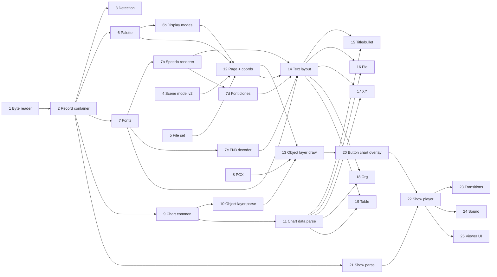

# Screen renderer: task breakdown

This plan splits the screen renderer for Harvard Graphics 3 files into tasks
that can each be built and tested on their own. Section numbers (§) refer to
[SPEC.md](SPEC.md).

The pipeline stays as the README describes it, with two additions: a file set
(because charts name palettes, fonts and bitmaps in other files) and a player
for shows.

```
bytes ─▶ record container ─▶ typed document (Chart / Show / Palette)
                                   │
          file set (palette, fonts, bitmaps) ─▶ scene builder ─▶ Scene ─▶ SVG
                                                                   ▲
                                         show player (slides, keys, buttons, transitions)
```

## Ground rules for every task

- **Parsers keep what they don't understand.** Store unknown records and
  sub-records as raw bytes (tag and data) so the hex inspector can show them
  and later decoding needs no re-parse.
- **Guesses live in one place.** Every value marked \[I\] or \[?\] in the spec
  that drives drawing (text size unit, transition numbering, default line
  width, pie start angle and so on) goes in `src/formats/hg3/assumptions.ts`
  with a comment citing the spec section. Reference renders (§7.3) will then
  mean editing one file.
- **Warnings, not exceptions.** Damaged or partial files produce a document
  plus a list of warnings (§7.1). Throw only when the signature is wrong.
- **Docs stay in sync.** A task that learns something about the format
  updates [formats.md](formats.md) (and SPEC.md's confidence marks) in the
  same change.
- **Tests use synthetic bytes.** Each parser task includes a small byte
  builder for tests. Real samples go in `samples-private/` and are covered by
  task 26.

## Dependency graph



Tasks 1, 4, 5 and 8 have no dependencies and can start in parallel.

---

## Phase 0: Foundations

### 1. Byte reader and text decoding

- **Build:** `ByteReader` over a `Uint8Array` with `u8`, `u16`, `i16`, `u32`,
  `f32`, `f64` (little-endian), `cstring()`, `paddedString(n)`, `skip`, `seek`,
  `remaining`. A table from byte codes to Unicode for strings (§1 Conventions, §6.4; now the Harvard Graphics set, task 7e).
- **Done when:** reading past the end throws a typed `TruncatedError`; the
  f64 "not set" pattern 0xFFF0000000000000 is exposed as `isNotSet()` (§3).

### 2. Record container

- **Build:** `readContainer(bytes)` returning signature, version (major,
  minor, document type), and a tree of records in which block pairs (500/501,
  504/505, 508/509, 516/517, 520/521, 524/525, 608/610) become nodes with
  children. Tag 516 keeps its 16 data bytes (§3).
- **Errors (§7.1):** wrong signature or version not first means reject; length
  past the end means stop and warn "damaged"; no tag 1 means warn; unknown tags
  are kept raw.
- **Done when:** a synthetic chart, show and palette parse to their last byte,
  and each error case has a test.

### 3. Detection by signature

- **Build:** replace extension detection in
  [hg-dos/index.ts](../src/formats/hg-dos/index.ts) with a check for HGB3, HGB1
  or HGA2 (confidence 1), keeping extension as weak evidence. Accept .CH3,
  .SH3, .PL3 and .PC3; drop .SY3, which is not needed for playback (§2). Rename
  the module to `hg3`.
- **Done when:** the registry test covers each signature and a Harvard
  Graphics 2 file is rejected with the §7.1 message.

### 4. Scene model v2

The current `Scene` has only text, rect and line. Extend
[types.ts](../src/formats/types.ts) and
[SceneRenderer.tsx](../src/render/SceneRenderer.tsx):

- **Coordinates:** scene units are page units with y flipped by the scene
  builder (scene y = −page y), so the SVG `viewBox` is
  `-16384 -12288 32768 24576` for landscape and the transpose for portrait
  (§6.1). Text then needs no counter-flip.
- **Elements:** `path` (polyline, polygon, curve), `ellipse`, `arc`, `band`
  (§5.6 0x1041), `rect` with corner style, `text` (font family, weight,
  italic, anchor start/middle/end), `image` (data URL plus box), and `group`
  with an affine transform and optional `buttonName` for hit testing.
- **Styles:** each shape gets `fill` and `stroke` (colour or none) and a
  stroke width.
- **Document:** add `warnings: string[]` and an optional `show` field (task 21).
- **Done when:** the renderer draws a hand-built scene containing every
  element kind, letterboxed to 4:3.

### 5. File set and resolver

- **Build:** a `FileSet` that holds every file the user dropped (several files
  or a whole folder through `webkitdirectory`). `resolve(name, nearFile)`
  matches case-insensitively, beside the naming file first, then anywhere in
  the set (§2). Missing names are recorded so the UI can list them.
- **UI:** [FileDropzone.tsx](../src/components/FileDropzone.tsx) accepts
  several files and folders; the viewer opens the first .SH3, else the first
  .CH3.
- **Done when:** a chart naming `hg3.pl3` finds `HG3.PL3`, and a missing
  palette shows up in the warnings.

---

## Phase 1: Resources

### 6. Palette

- **Parse:** .PL3 and .PC3 (§6.2): tags 1551, 1552, 1553 into 64 entries of
  name and RGB. Keep 1554 and 1555 raw.
- **API:** `palette.color(role)`: role 0 means none; role r is entry r − 1; out
  of range falls back to the default palette (§7.1).
- **Fallback (decided):** ship a built-in copy of HG3.PL3's 64 names and RGB
  values, generated from `samples-private/PALETTE/HG3.PL3` by a small script
  and committed as `src/formats/hg3/defaultPalette.ts`.
- **Done when:** a chart without a 404 kind 2 reference uses HG3.PL3 from the
  file set, else the built-in copy; an empty or missing palette also falls
  back to the built-in copy.

### 6b. Display modes (EGA, VGA, monochrome)

Harvard Graphics 3 supported EGA (640 × 350, 16 of 64 colours), EGA
Monochrome (640 × 350), VGA (640 × 480, 16 colours) and, from 3.05,
Hercules (720 × 348). It never supported CGA; a 256-colour VGA driver was
planned but not shipped. (Research from the 3.0 and 3.05 installer scripts
and SPC's hardware requirements; see formats.md.) The viewer lets the user
pick the display it imitates; the choice only changes how palette RGB values
become screen colours, applied after task 6.

| Mode | Colours | Rule |
| --- | --- | --- |
| VGA (default) | 16 at once | Stored RGB, rounded to the VGA DAC's 6 bits per channel |
| EGA | 16 at once, chosen from 64 | Each role maps to the nearest of the 64 EGA colours (2 bits per channel); if a scene uses more than 16, keep the 16 most used |
| Monochrome screen (EGA Mono / Hercules), imitation | 2 | Text and lines always in the foreground colour; fills as ordered-dither patterns by brightness. How the program itself drew colour charts on these displays is unknown \[I\] |
| Modern | Full 24-bit | Stored RGB unchanged |

The MONOCHRB and MONOCHRW palettes are greyscale palettes a chart author
picks (black or white background), not a screen mapping. Task 6c adds them
as an option.

### 6c. Greyscale palette option

**Done.** Settings → Palette: as saved, MONOCHRB or MONOCHRW. Built-in
copies of both palettes are generated like the HG3.PL3 copy. Colours stored
as direct RGB (not roles) stay in colour. Changing the palette keeps the
show's position and presentation mode when the show's structure is
unchanged. Palettes with a built-in copy (MONOCHRB, MONOCHRW, HG3.PL3) are
looked up without being listed as missing files; HG3.FGF is listed only when
it matters (an unknown font key, or an .SPD found without it).

Draw a chart with the program's own MONOCHRW.PL3 or MONOCHRB.PL3 in place of
its palette (role for role), as a 1991 user would by changing palettes. Falls
back to the current palette when the files are missing.

### 7. Font resolution and look-alikes

Decided: use the original fonts when the user's files include them;
otherwise substitute look-alikes.

- **Parse:** HG3.FGF (§2) from the file set: font key to display name, font
  file name and character map. If FGF is missing, use a built-in table for
  the two keys the samples use.
- **Resolve:** for each font key, look for its .SPD or .FN3 file in the file
  set. Found: draw with it (tasks 7b and 7c). Not found: use a look-alike.
- **Look-alikes (§6.4):** Swiss 721 to Helvetica/Arial, Dutch 801 to Times,
  Geo Slab 712 to Rockwell, Monospace 821 to a monospace sans, with weight and
  italic from the style word. For the HG stroke fonts, bundle open
  single-stroke Hershey fonts (public domain) so they keep their drawn-line
  look.
- **Text size:** `textSizeToUnits(size, page)`, using percent of the page's
  shorter side (§6.4), defined in `assumptions.ts`.
- **Done when:** the viewer lists which fonts came from the files and which
  were substituted.

### 7b. Speedo font renderer (.SPD)

- **Build:** read Bitstream Speedo outline fonts (§2, §7.5) and turn each
  glyph into an SVG path, so text renders as paths in the original typeface.
  Use the FGF character map to go from byte code to glyph.
- **Notes:** follow Bitstream's published format; the X11 Speedo rasteriser
  is the reference implementation. Cache glyph paths per font.
- **Done when:** a line of text drawn with BX000003.SPD matches the substitute
  in position and size, in the original letterforms.

### 7c. FN3 stroke font decoder

- **Blocked:** the FN3 glyph layout is not documented (§7.2 item 8). This
  task starts with reverse-engineering it from the files in
  `samples-private/FONT/` and adding a section to SPEC.md, then draws glyphs
  as stroked paths. Until then the Hershey look-alikes from task 7 apply.

### 7d. Our own font clones (decided)

Fonts made by this project for all 22 faces in the font index, shipped with
the viewer so output looks right without the original font files. They
replace the system look-alikes of task 7 as the fallback; the original fonts
still win when the user loads them.

- **Order:** Swiss 721 Roman and Dutch 801 Bold first (the two keys the
  samples use), then the HG stroke fonts, then the remaining Speedo faces.
- **Metrics first (needs task 7b):** measure each original's advance widths,
  ascent, descent and cap height from the .SPD files with the task 7b
  reader, and store them as a metrics table per face. Metrics are facts about
  the font, not its outlines, and are what make layout match.
- **7d-1 Stroke clones:** build the four HG families from the public-domain
  Hershey font data (the HG fonts descend from it, §2). Pick the matching
  Hershey set per family (Roman, Sans serif, Script, Gothic), map byte codes
  to glyphs, and scale them to the originals' metrics. Light and Bold differ
  by stroke width.
- **7d-2 Outline clones:** start from open-licensed fonts of the same design
  family (Helvetica-style sans for Swiss 721, Times-style serif for Dutch
  801, a geometric slab for Geo Slab 712, a sans mono for Monospace 821),
  chosen under licences that allow modified copies (for example the SIL Open
  Font License). Adjust advance widths and vertical metrics to the measured
  table; keep the source licence and its renaming rules.
- **Never** trace, convert or derive outlines from the .SPD or .FN3 files.
- **Names:** our own family names; Swiss 721, Dutch 801 and the others are
  Bitstream names. Font keys map to clones in a table.
- **Format:** an SVG-path glyph table (the same shape tasks 7b and 7c
  produce), with an optional WOFF2 build so the fonts also work as CSS fonts.
- **Done when:** a chart drawn with the clone and with the original font
  lines up to within a few units per line, for each face.

### 7e. Harvard Graphics character set

The upper half of the byte codes is the Harvard Graphics set (close to code
page 850), not CP437 (§1, §6.4). **Done:** text decoding in the parsers now
uses src/formats/hg3/charset.ts, the old CP437 table is removed (moved to a shared
place), keep file names as raw ASCII, and keep the byte codes on text runs so
fonts can draw by code.

### 7f. Draw text with original fonts and clones

**Done.** Text is drawn as glyph paths (`glyphs` scene element) from the
original .SPD when loaded, else our outline or stroke clone, else CSS. An
async `prepare` step on the parser (awaited by `loadEntry`/`loadFileSet`)
finds the font keys a document uses and loads the clone faces before the
synchronous parse; the chart warnings end with a "Fonts:" line naming the
source of each font, which also covers task 7's done-when.

Text elements are drawn as paths: with the original .SPD font when loaded
(task 7b reader), else with our outline or stroke clone (7d), else with a CSS
look-alike. Needs a scene element for glyph paths or text rendered as a path.

### 8. PCX decoder

- **Build:** decode ZSoft PCX/PCC (RLE, 1, 4 and 8 bit, with palette) to RGBA,
  then to a data URL for `image` elements (§6.3).
- **Done when:** synthetic 1-, 4- and 8-bit images decode correctly. This is
  low priority; only backgrounds, logos and pattern fills need it.

---

## Phase 2: Chart parsing

### 9. Chart common records

- **Parse into a `Chart` object:** chart type (§3), description, 404
  references by kind, page areas 802 to 810, page setup 816, 814 button names,
  text lines 800 with the shared 22-byte **text tail** reader (§5.3), and
  style tables (906, 1002, 1102, 1202, 1308, 1412) into a lookup by slot.
- **Done when:** text lines group by slot, row and column, and a line missing
  a value takes it from the style table.

### 10. Object layer parsing

- **Parse (§5.6):** 516 boxes; groups 608/610 (nested); each object as
  transform 616, optional button name 618, optional raw 614, and object 612
  with bounding box, flags and sub-records up to 0x1FFF (or the record end).
- **Shapes:** decode every sub-tag in the §5.6 shape table into a typed
  shape. The text block 0x10B0 reads its runs with the text tail from task 9,
  and keeps its header fields raw.
- **Attributes:** decode 0x1100 (line role, width/style byte), 0x110B (fill
  role) and 0x1140 (bitmap); keep the others raw.

### 11. Chart data parsing (one sub-task per type)

| Sub-task | Records | Output |
| --- | --- | --- |
| 11a Pie | 1304 to 1316, slot 5 | Pies, each a list of slices (value, label, colour role); options raw |
| 11b XY | 1402, 1406, 1408, 1422, 1424, slots 3 and 4 | Series (colour role, marker, raw style bytes), X labels, sparse value grid, axis settings with not-set handling |
| 11c Organisation | 900 to 914 | Boxes with level, name, title and comment, built into a tree (§5.4) |
| 11d Title and bullet | slots 7 and 8, 1106, 1108 | Lines, plus bullet shape, colour and indent per line |
| 11e Table | slot 6, 1206 to 1214 | Cell grid; 1208 and 1214 as candidate column widths and row positions |

---

## Phase 3: Scene building (drawing a chart)

> **Replanned after task 13.** Every sample data chart stores a drawn copy of
> itself in the object layer, so task 13 already draws all 238 sample charts.
> New priority: task 13b fixes the remaining object-drawing gaps, and task 13c
> draws embedded charts. Tasks 14 to 19 (layout from data) become a fallback
> for charts without a stored copy; none exists in the samples, so they come
> after the show tasks.

### 12b. Page size from 816

Letter pages (816 width × height 11 × 8.5 in, and portrait 8.5 × 11) use a
taller unit range: y up to about ±12660 for landscape Letter, so the fixed
±12288 viewBox clips them, and text sizes are a percentage of 25321
(32768 × 8.5/11) there, not 24576. Derive the viewBox and the text size base
from 816 (§6.1 [I]).

**Done.** Long side 32768, short side 32768 × short/long; viewBox and text
size base from 816; viewer pages take their own aspect ratio, players and
thumbnails letterbox.

### 13b. Object drawing fixes

Pie slices draw unfilled (only an outline circle); bullet markers draw as tiny
dots. Find the cause in the samples (PIETUT, the GALD2xx pies, the GALD1xx
bullets), fix it, and check every chart type visually.

### 13c. Embedded charts

A 616 transform, a 404 kind 4 reference and an empty 608 group embed another
chart, scaled into place (LDOUBLEP, LFOURL, PDOUBLEL, PFOURP). Draw the named
chart's scene inside the group, guarding against a chart that embeds itself.

### 12. Page, coordinates and background

- **Build:** `buildChartScene(chart, fileSet)`: choose orientation from 816,
  set the viewBox, fill with FrameBkg (role 15) and draw the frame (role 14)
  (§5.5 step 1). This is also where the palette is resolved.
- **Done when:** an empty chart renders as a coloured 4:3 page, or 3:4 in
  portrait.

### 13. Object layer drawing

- **Build:** turn each parsed object into scene elements: apply the 616
  transform (all six terms), map shapes (angles in tenths of a degree,
  counter-clockwise; §5.6), and use the interim colouring rule (fill from
  0x110B or else 0x1100, outline from 0x1100). Groups become `group`
  elements; objects with a 618 name get `buttonName`. A 0x1140 object draws
  its PCX stretched to its bounding box.
- **Done when:** a drawing chart (type 0x29) renders completely. Drawings
  need nothing else.

### 14. Text layout

- **Build:** a shared helper that lays out lines in an area (title, footnote,
  plot, text box): stacks lines from the top, sets each line's height from its
  size, applies justification relative to the area, colour from the role and
  font from task 7 (§5.5 steps 2 and 3, §6.4).
- **Done when:** title and footnote text appears on every data chart. All of
  tasks 15 to 19 use this helper.

### 15. Title and bullet charts

Lines stacked in the plot area; bullets get a marker in role 16, indented by
level (§5.5).

### 16. Pie chart

Slice angles from values, starting at 0° and going counter-clockwise (both
values in `assumptions.ts`). Fill by role, outline in role 32, labels outside
on the slice's middle line. Several pies are spaced evenly with slot 5
titles. Negative values are skipped with a warning (§7.1).

### 17. XY chart

Split into:

- **17a Axes:** automatic range and "nice" tick steps where 1402 says not
  set; frame, grid, tick labels, X labels from 1422, axis titles from slot 3.
- **17b Bars:** clustered by default; stacked and overlapped once 1406 is
  decoded.
- **17c Lines, areas, points:** markers from 1406 byte 14.
- **17d Legend:** in the 810 area with slot 4 names and series colours
  (roles 21 to 26, repeating).

Until the series type byte is decoded (§7.2 item 3), draw every series as a
bar and keep the type switch in `assumptions.ts`.

### 18. Organisation chart

Tree layout: top level at the top, children spread evenly under their
parent, connector lines in role 18, three text fields per box.

### 19. Table chart

A grid in the plot area. Use 1208 and 1214 for sizes if they turn out to be
widths and positions, else divide evenly. Cell text uses task 14.

### 20. Button chart overlay

If a chart has a 404 kind 1 reference, load that chart from the file set and
draw its object layer on top, keeping button names (§4.4, §6.5).

---

## Phase 4: Shows (the Projector)

### 21. Show parsing

702 slide entries grouped with their 404 kind 20, 704 key and 706 button
records (§4.1 to 4.4). Slide kinds as in §4.2, with unknown kinds treated as
empty. Raw fields for 708 to 714 and the unknown 702 bytes.

### 22. Show player

- **State machine (§4.7):** current slide, history (for "lastview"), and a
  stack of nested shows with a guard against a show including itself.
- **Input:** key lookup in this order: slide key table, then the show-wide
  table (slide 0), then default keys. Clicks hit-test `buttonName` groups
  against the slide's 706 table, ignoring case and trailing spaces.
  Destinations as in §4.6.
- **Timing:** auto-advance when the display time is set (702 offset 14,
  \[I\]).
- **Missing slide file:** an empty slide showing the file name.
- **Done when:** a synthetic three-slide show with a key table and one button
  navigates correctly in tests, with no rendering involved.

### 23. Transitions

Render the old and new slide as two stacked SVG layers and animate with CSS
clip-path and transforms: Replace, Overlay, Wipe ×4, Scroll ×4, Fade
(dissolve), Open, Close, Blinds, Iris In/Out, and Keep (§4.5). Durations 1.5 s,
0.75 s and 0.3 s. The 702 offset 11/12 mapping goes in `assumptions.ts`.


**Done.** The guessed mapping (SPEC §4.5) lives in `assumptions.ts`; the
HG3 code fills the format-independent `PresentationSlide.transitionGuess`,
which the player's "Guessed" mode reads. Default mode is Off.

### 24. Sound slides (optional)

Play WAV through an `<audio>` element and continue at once; skip MIDI with a
warning, or add a MIDI synth later.

---

## Phase 5: Viewer and verification

### 25. Viewer UI

Presentation mode (full screen, 4:3 letterboxed, keyboard and click
navigation), a slide strip for shows, a warnings and missing-files panel, and
the existing hex inspector with the record tree from task 2 alongside.

### 26. Sample regression suite

A Vitest suite that runs only when `samples-private/` contains files (skipped
otherwise, so CI passes without them). It checks that:

- every document parses to its last byte with no "damaged" warning (the §3
  claim)
- every chart builds a scene without throwing
- the slide kind in every show equals its chart's document type (§4.2).

Later, once reference screenshots exist (§7.3), add visual comparisons here.

---

## Decisions

1. **Default palette:** copy HG3.PL3 (task 6), and imitate period displays
   (CGA, EGA, VGA) through display modes (task 6b).
2. **Fonts:** use the original .SPD and .FN3 fonts when the files include
   them (tasks 7b, 7c); otherwise substitute look-alikes (task 7). Making our
   own clones of the fonts as the fallback is decided
   (task 7d, now decided: clones for all 22 faces). The built-in font
   table holds the full 22-entry catalogue of the original HG3.FGF.
3. **Docs:** [formats.md](formats.md) is kept in sync with the work. Every task
   that confirms, corrects or adds to the format updates formats.md (what was
   verified, against which sample) and SPEC.md if a mark changes, in the same
   change as the code.
